# AI Financial Crime Intelligence Platform

<p align="center">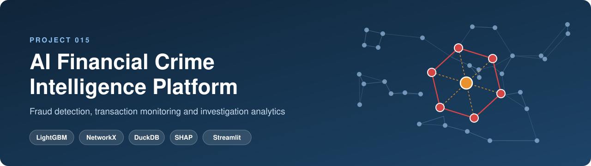</p>

<p align="center">
  <a href="https://github.com/muhammadzubair-data/ai-financial-crime-intelligence/actions/workflows/ci.yml"></a>
  
  
  
  
</p>

<!-- LIVE-DEMO -->

A working investigation platform for banks, fintechs, payment processors and compliance teams. It scores transactions, finds connected accounts and fraud rings, monitors AML patterns, and gives an investigator one place to review the evidence, record a decision and export a case report.

Most fraud projects stop at a trained model. This one carries the prediction through to the investigator's desk: which accounts to open first, why each one was flagged, who it is connected to, and what was decided.

> **Synthetic data.** Every account, transaction and network in this repository is simulated. Nothing describes a real person, bank or transaction. Results show that the pipeline works end to end; they are not a forecast of performance on real data.

<p align="center">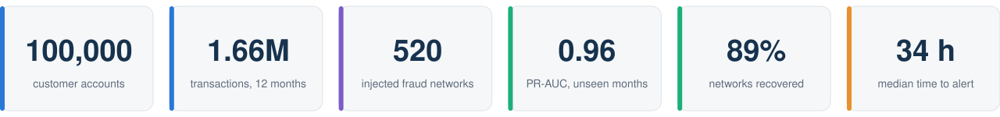</p>

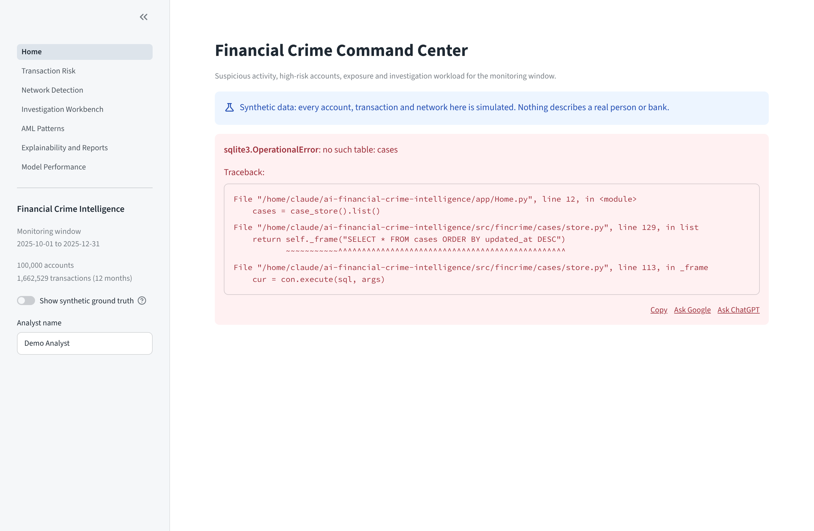

## Contents

[What is in it](#what-is-in-it) · [How it works](#how-it-works) · [The data](#the-data) · [Results](#results) · [Screenshots](#screenshots) · [Quick start](#quick-start) · [Project structure](#project-structure) · [Limitations](#limitations)

## What is in it

| Module | What it does |
|---|---|
| **Financial Crime Command Center** | Open alerts, critical cases, flagged transactions, exposure, detected networks and investigation workload |
| **Transaction Risk Scoring** | LightGBM model scores every transaction; a slider shows the precision and recall you get for a given number of alerts per day |
| **Fraud Ring and Network Detection** | NetworkX links suspect accounts through flagged transfers and shared devices, and draws each network with inferred roles |
| **Investigation Workbench** | Timeline, transactions, counterparties, network view and evidence for one account, plus a decision form with notes and an audit trail |
| **AML Pattern Monitoring** | Four scenario rules: structuring, rapid movement of funds, circular transfers and fan-in |
| **Explainable Risk and Reports** | SHAP drivers turned into plain sentences; case reports exported as HTML, Markdown or JSON |
| **Model Performance** | Results against three baselines, recall by typology, investigation effectiveness and stated limitations |

## How it works

<p align="center">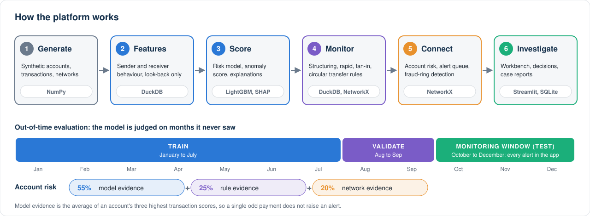</p>

## The data

<p align="center">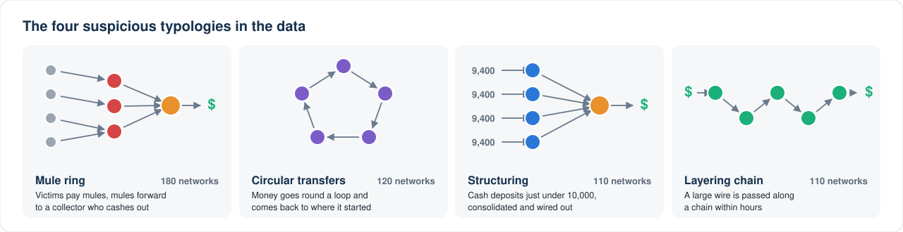</p>

| | |
|---|---|
| Customer accounts | 100,000 |
| Transactions | 1,662,529 |
| History | 12 months (January to December 2025) |
| Injected suspicious networks | 520 (180 mule rings, 120 circular, 110 structuring, 110 layering) |
| Accounts in those networks | 3,338 |
| Suspicious transactions | 20,943 (1.3% of all transactions) |

One network in five (111 of 520) is a "stealth" variant with smaller amounts and much slower movement. Legitimate activity includes deliberate look-alikes: cash-heavy businesses depositing just under 10,000, payroll runs, marketplace sellers paid by many strangers, flat-share loops, house purchases and households sharing a device.

## Results

The model is trained on January to July, tuned on August and September, and judged on **October to December**, which it never saw. Every alert in the app comes from that last window.

### Transaction scoring

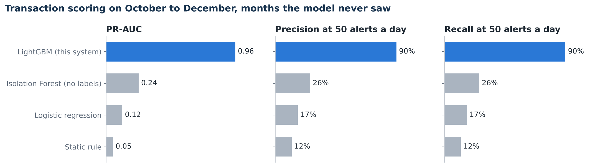

| Model | PR-AUC | Precision at 50 alerts/day | Recall at 50 alerts/day |
|---|---|---|---|
| **LightGBM (this system)** | **0.96** | **90%** | **90%** |
| Isolation Forest (no labels) | 0.24 | 26% | 26% |
| Logistic regression baseline | 0.12 | 17% | 17% |
| Static rule baseline (10k+ or high-risk corridor) | 0.05 | 12% | 12% |

At its operating threshold the model raises 54 transaction alerts a day at 85% precision and 92% recall. The static rule raises 142 a day at 9% precision and 25% recall. Recall on stealth networks is lower, 81% against 95% for standard ones.

### Account alerts and investigation effectiveness

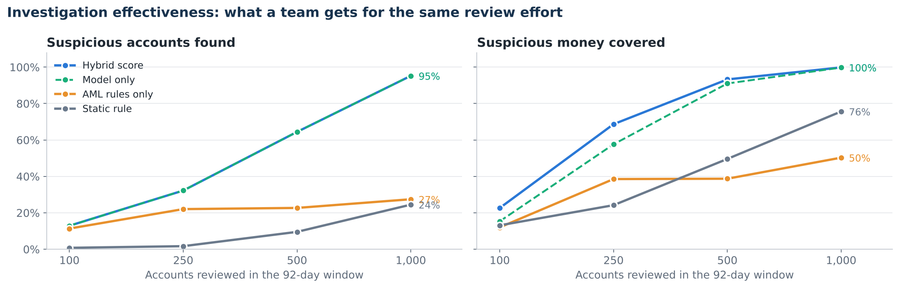

- **725 account alerts** over 92 days (55 a week). 98% are true network members, covering 91% of the 776 suspicious accounts active in the window.
- Reviewing the **top 500 accounts** by the hybrid score reaches 64% of suspicious accounts and 93% of the suspicious money. The same effort spent on the static rule reaches 10% and 50%.
- **Honest finding:** adding rules and network evidence to the model score does not improve account ranking on this data (PR-AUC 0.966 hybrid against 0.973 for the model alone). Their value is in explaining the alert and grouping accounts into networks.

### Network detection

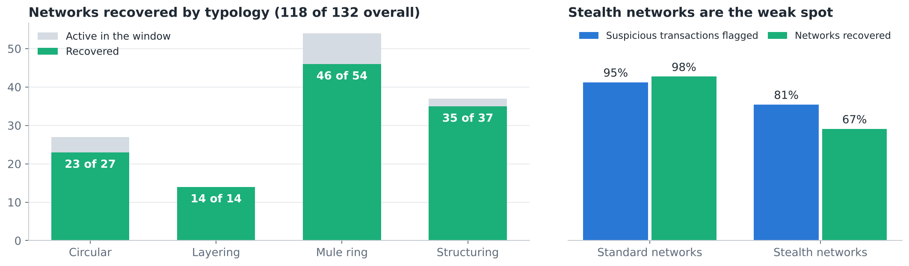

- 132 injected networks were active in the window. **118 (89%) were recovered**, meaning at least half of their active members landed in one detected network. 95% were touched by at least one alert.
- 113 of the 119 detected networks are mostly real.
- Stealth networks are much harder: 67% recovered, against 98% of standard ones.
- For the 87 networks that began inside the window, the median time from first suspicious transaction to first alert is 34 hours.

### AML rules on their own

| Rule | Instances (full year) | Precision | Networks of the target type touched |
|---|---|---|---|
| Structuring | 4,137 | 9% | 82% |
| Circular transfers | 4,930 | 35% | 93% |
| Rapid movement | 3,581 | 79% | 62% |
| Fan-in | 458 | 38% | 42% |

The rules are noisy by design: the legitimate look-alikes trigger them, as they would in a real bank. That is the case for combining them with a model.

## Screenshots

| | |
|---|---|
| 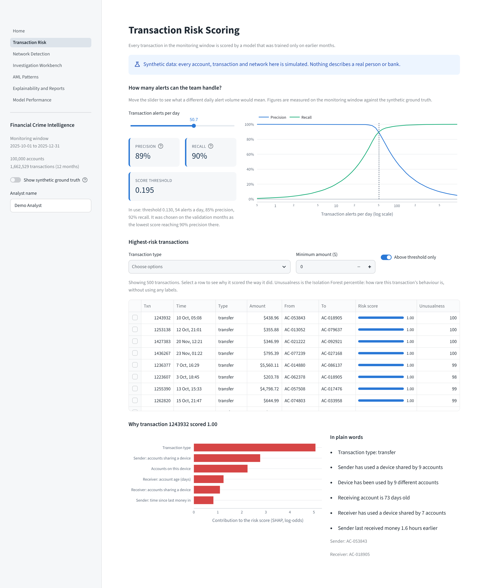 | 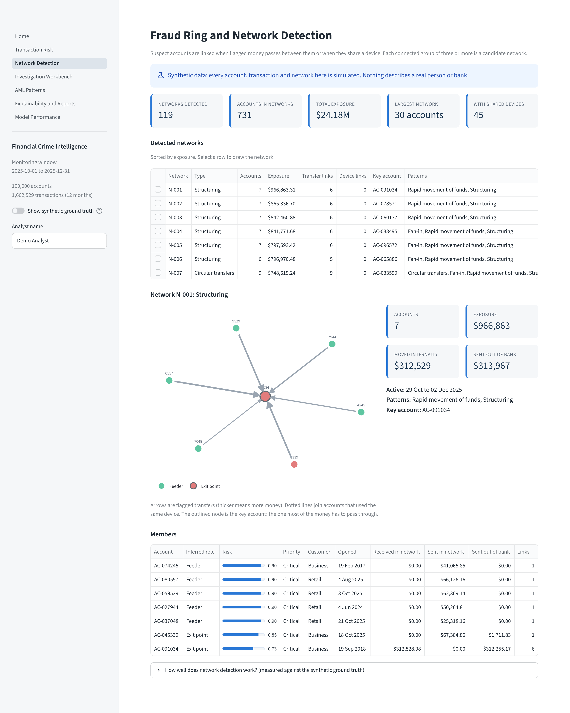 |
| 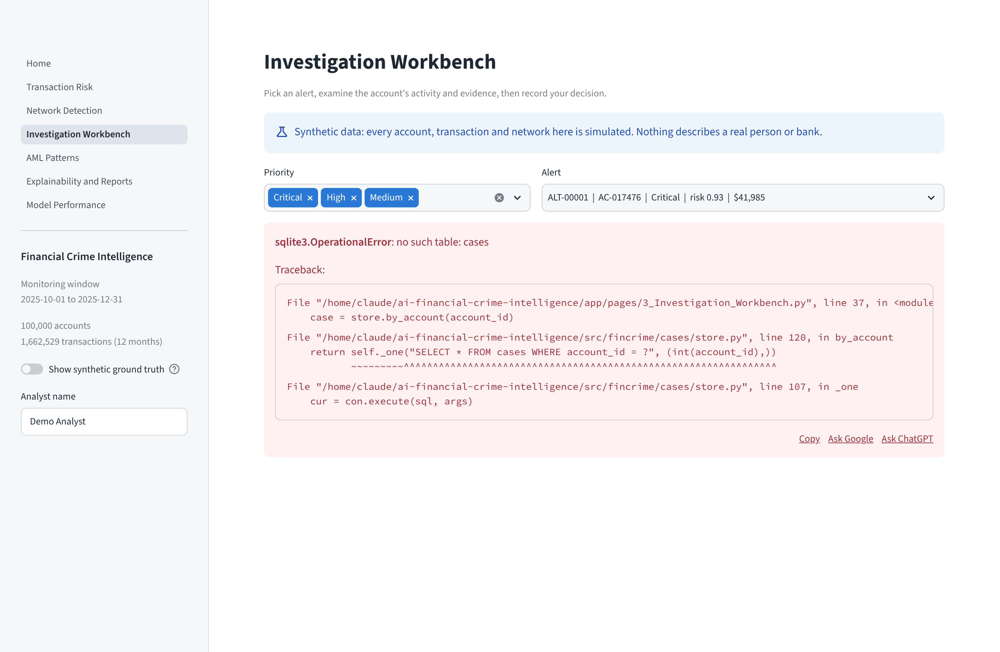 | 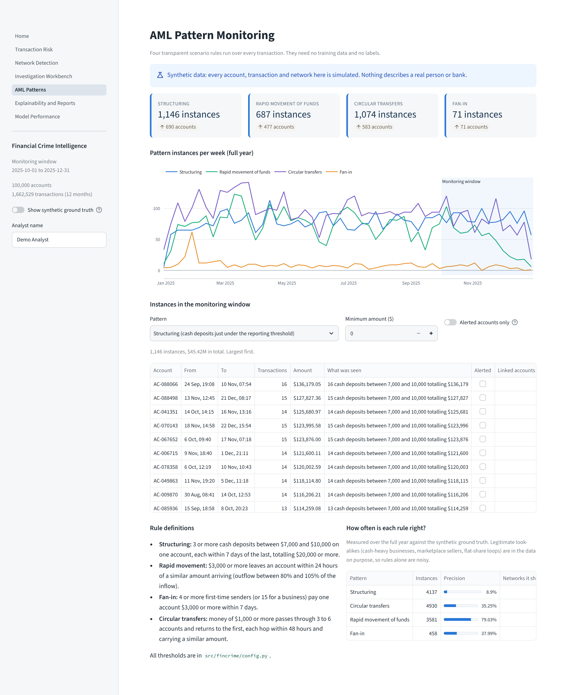 |
| 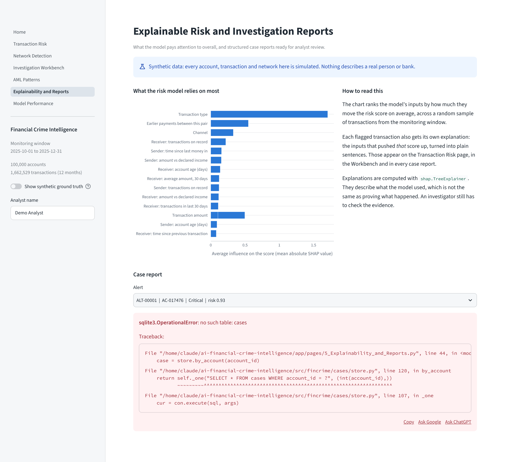 | 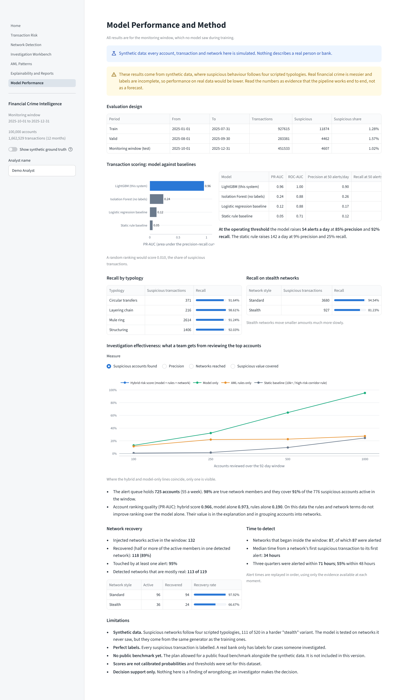 |

## Quick start

```bash
git clone https://github.com/muhammadzubair-data/ai-financial-crime-intelligence.git
cd ai-financial-crime-intelligence
pip install -r requirements.txt
pip install -e .

streamlit run app/Home.py
```

To run only the app, `pip install -r app/requirements.txt` is enough (Streamlit, pandas, Plotly, NetworkX). The full `requirements.txt` adds what the pipeline and tests need.

The repository ships with the app-ready outputs of a full-scale run in `artifacts/` (about 10 MB), so the app opens straight away.

To regenerate everything from scratch:

```bash
python -m fincrime.pipeline --scale full      # 100k accounts, 1.6M transactions, about 3 minutes on 2 cores
python -m fincrime.pipeline --scale medium    # 20k accounts, under a minute
python -m fincrime.pipeline --scale small     # 3k accounts, used by the tests
```

The full transaction data (about 200 MB with features) is written to `data/`, which is git-ignored. Generation is seeded, so the same command gives the same data.

```bash
pytest -q        # 31 tests, about 25 seconds
```

## Method in more detail

1. **Features (DuckDB).** Each transaction is written to a ledger twice, once for the paying account and once for the receiving account. Rolling windows over that ledger give sender-side and receiver-side behaviour: money in and out over 24 and 72 hours, distinct counterparties, pass-through ratio, cash deposits just under the threshold, device sharing, account age. Every feature looks strictly backwards in time.
2. **Transaction risk (LightGBM).** Trained on the first seven months with early stopping on the next two. The alert threshold is the lowest score that reaches 90% precision on validation.
3. **Anomaly score (Isolation Forest).** An unsupervised view of how unusual a transaction is, shown beside the risk score and used as a no-labels baseline.
4. **AML rules.** Four transparent scenarios with thresholds in `config.py`. The circular rule is a time-respecting cycle search, narrowed with strongly connected components.
5. **Account risk.** `0.55 x model + 0.25 x rules + 0.20 x network`. Model evidence is the mean of an account's three highest transaction scores, so one odd payment (a scam victim's, for example) does not raise an alert.
6. **Networks (NetworkX).** Suspect accounts are joined by flagged transfers and shared devices. Connected groups of three or more become candidate networks, with roles inferred from money flow.
7. **Explanations (SHAP).** TreeExplainer contributions for each flagged transaction, mapped to plain sentences.
8. **Case management.** SQLite store with status, decision, notes and an audit trail.

More detail: [`docs/METHODOLOGY.md`](docs/METHODOLOGY.md), [`docs/DATA_DICTIONARY.md`](docs/DATA_DICTIONARY.md), [`docs/MODEL_CARD.md`](docs/MODEL_CARD.md).

## Project structure

```
ai-financial-crime-intelligence/
├── app/                      Streamlit app (Home + 6 pages)
├── src/fincrime/
│   ├── config.py             paths, scale presets, time windows, every threshold
│   ├── data/generate.py      synthetic accounts, transactions and networks
│   ├── features/build.py     DuckDB feature engineering
│   ├── models/               training, baselines, evaluation, SHAP
│   ├── aml/rules.py          structuring, rapid movement, fan-in, circular transfers
│   ├── graph/network.py      network detection and evaluation
│   ├── alerts.py             account risk, alert queue, investigation effectiveness
│   ├── cases/store.py        case management (SQLite)
│   ├── reports/              case report builder and renderers
│   └── pipeline.py           runs everything end to end
├── artifacts/                compact outputs the app reads, plus trained models
├── scripts/                  builds the README graphics from the saved results
├── tests/                    31 tests
├── docs/                     methodology, data dictionary, model card
└── .github/workflows/ci.yml  runs the pipeline at small scale and the tests
```

## Technology

Python, Pandas, DuckDB, LightGBM, scikit-learn (Isolation Forest, logistic regression), NetworkX, SHAP, Streamlit, Plotly, Pytest, GitHub Actions.

## Limitations

- **Synthetic data with scripted typologies.** The model is tested on networks it never saw, but they come from the same generator as the training networks. Real financial crime is more varied, and real performance would be lower.
- **Perfect labels.** Every suspicious transaction is labelled here. A real bank only has labels for cases someone investigated.
- **No public benchmark included.** The project plan allowed for a public fraud benchmark alongside the synthetic data. This version uses synthetic data only.
- **Jurisdiction codes are fictional** (XA to XT), so no real country is marked high risk. A production system would use its own country-risk list.
- **Scores are not calibrated probabilities**, and thresholds were set for this dataset.
- **Decision support only.** An alert is a reason to look, not a finding of wrongdoing.

## Author

Muhammad Zubair | [ZubairLabs](https://zubairlabs.com/) | [GitHub](https://github.com/muhammadzubair-data)

Released under the MIT licence.
